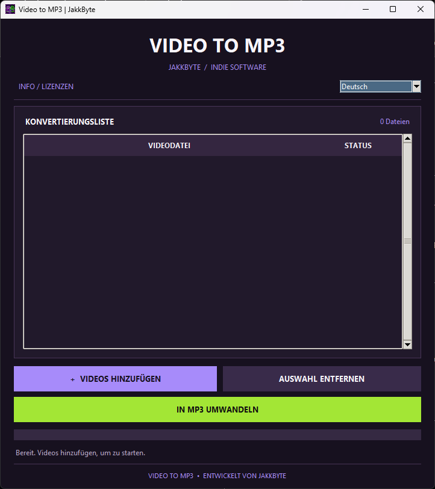

# 🎵 Video to MP3 | JakkByte

**A free, lightweight video-to-MP3 converter for Windows.**

Video to MP3 is a simple desktop application developed by **JakkByte**. Extract audio from multiple video files with an easy-to-use interface, batch conversion, and multilingual support.

## 📸 Screenshot

## ✨ Features

- 🎬 Convert video files to MP3 audio
- 📂 Batch conversion — process multiple videos in one queue
- 🎨 Modern dark interface with JakkByte styling
- 🌍 Support for 5 languages
- ⚡ Background processing to keep the interface responsive
- 🔒 Prevents overwriting existing MP3 files
- 📊 Conversion progress and individual file status
- 💻 Designed for Windows

## 🎞️ Supported Video Formats

MP4, MKV, AVI, MOV, WMV, WEBM, FLV, MPEG, MPG, M4V, and 3GP.

## 🌍 Available Languages

- English
- Portuguese (Brazil)
- Spanish
- French
- German

Your selected language is saved automatically.

## 📥 Download & Installation

1. Open the **[Releases](https://github.com/JakkByte/Video-to-MP3/releases)** section of this repository.
2. Download `Video-to-MP3.exe` from the latest release.
3. Run the application on Windows.

No Python installation is required when using the packaged executable.

## 🚀 How to Use

1. Click **Add Videos** to select one or more video files.
2. Review the files in the conversion queue.
3. Click **Convert to MP3**.
4. Wait for the conversion to finish.
5. Find the MP3 files in the same folders as the original videos.

Existing MP3 files will not be overwritten.

## 🛠️ Built With

- Python
- Tkinter
- FFmpeg (via `imageio-ffmpeg`)
- PyInstaller (Windows executable packaging)

## 👨‍💻 Developer

**JakkByte — Indie Software**

Independent software development focused on practical, accessible, and easy-to-use applications.

GitHub: https://github.com/JakkByte

## 📜 License

The application source code is released under the **MIT License**.

FFmpeg and third-party dependencies are subject to their respective licenses. See the accompanying third-party license information for details.

---

**Developed by JakkByte** 🐺
